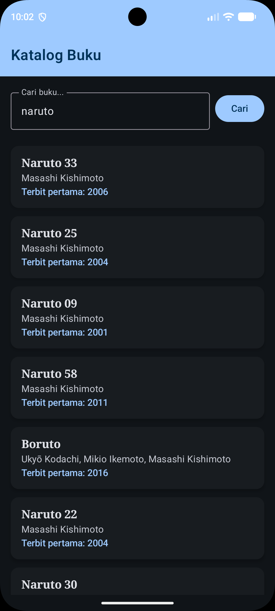
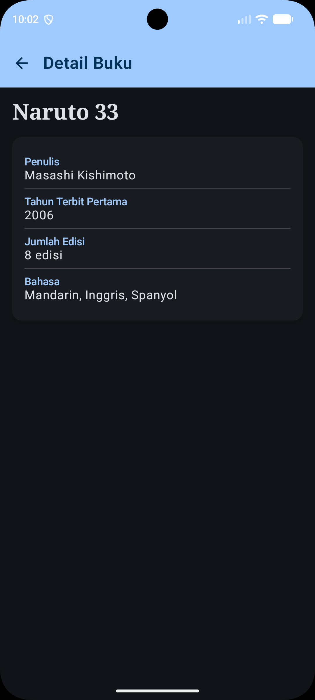

# Responsi Praktikum Pemrograman Mobile Shift H - Katalog Buku

**Nama** : Revaldi Enzha Agviandry P.
**NIM** : H1D024094
**Shift** : H

## Deskripsi
Aplikasi mobile untuk mencari dan melihat katalog buku dari OpenLibrary API.

## Screenshot
| Home | Detail |
|---|---|
|  |  |

## Fitur
- Pencarian buku berdasarkan kata kunci
- Daftar buku (judul, penulis, tahun terbit pertama) dengan LazyColumn
- Detail buku (judul, penulis, tahun, jumlah edisi, bahasa)
- Loading state, error state (dengan tombol coba lagi), dan empty state
- Light/Dark theme

## Arsitektur (MVVM)
View (Composable) → ViewModel → Repository → Retrofit ApiService → OpenLibrary
- `BookUiState` (sealed interface): Loading / Success / Error via StateFlow
- Home & Detail berbagi satu ViewModel; detail memakai data item terpilih (via index navigasi), tanpa API call kedua

## API
- Base URL: https://openlibrary.org/
- Endpoint: `GET /search.json?q={keyword}&limit=20`
- Field dipakai: title, author_name, first_publish_year, edition_count, language, key

## Teknis
- Kotlin (data class, null safety, lambda, extension function)
- Jetpack Compose, Material 3, Navigation Compose
- Retrofit + Gson converter
- minSdk 29